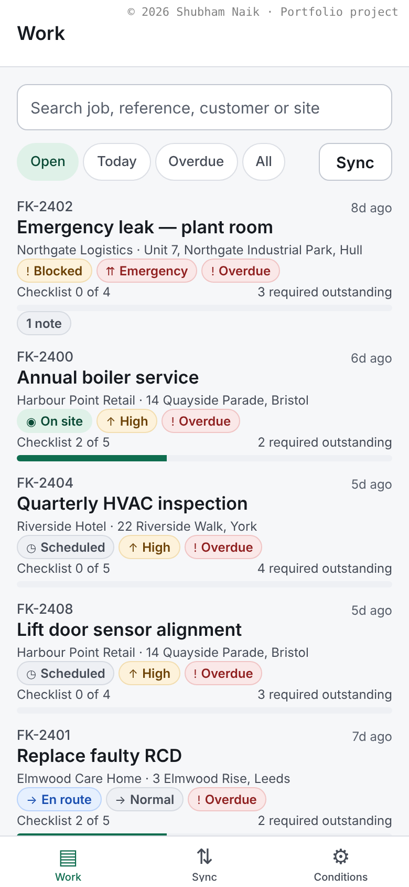
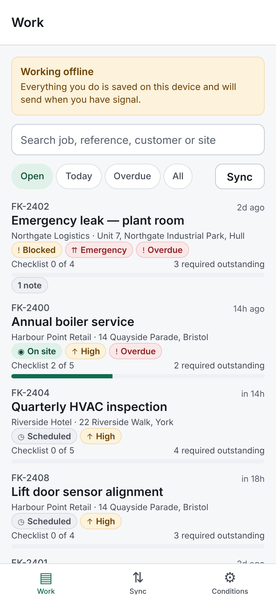
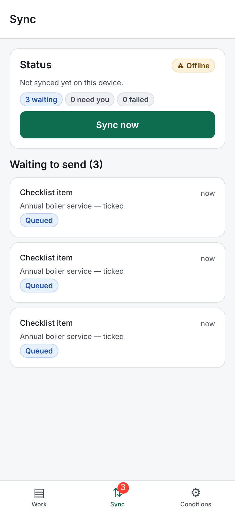
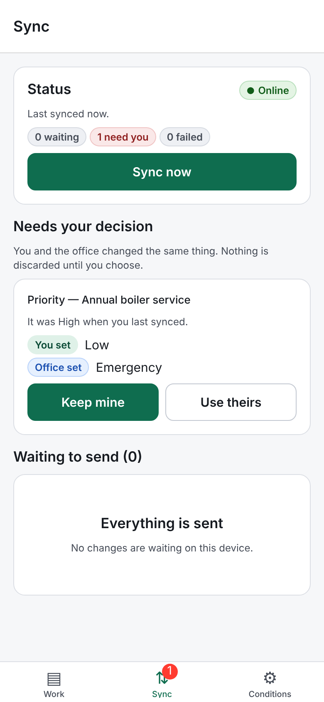

# FieldKit — offline-first field-service app

A React Native (Expo) app for field technicians who work where there is no signal: a job list, a job detail screen with checklist and notes, a durable **outbox** of unsent changes, a **sync engine** with a three-way merge, and a **conflict-resolution** screen for the cases a machine should not decide.

> **Personal portfolio project.** Built by Shubham Naik in October–November 2026 as independent work — not a client deliverable and not software used by any employer. Every job, customer and address is invented and generated from a fixed seed.

| | |
|---|---|
| **Live demo** | [shub808.github.io/fieldkit-mobile/](https://shub808.github.io/fieldkit-mobile/) |
| **Stack** | Expo SDK 58 · React Native 0.88 · React 19 · expo-router · TypeScript (strict+) · AsyncStorage · Jest + React Native Testing Library |
| **Tests** | 122 passing (Jest): 5 unit suites in a Node project, 2 component suites in a `jest-expo` project |
| **Quality gates** | `tsc --noEmit` · ESLint 9 (flat, `eslint-config-expo`) · Jest · `expo export --platform web` — all pass locally, all run in CI |



## Why this project exists

Most "offline" demos cache GET responses. The hard part is **writes**: a technician completes a job in a basement, the office edits the same job from a desk, and the phone finds signal ninety seconds later. FieldKit is built around that moment.

## What it does

- **Local-first writes.** Every change is applied to the device's own copy immediately and appended to a persisted outbox. Nothing waits on a network.
- **Sync engine.** Drains the outbox in order, with exponential backoff and full jitter, and idempotent mutations so a retried request cannot apply twice.
- **Three-way merge.** Local, server and the *baseline* the user last saw are compared field by field. Non-overlapping edits merge silently; checklist ticks and notes are unioned; only a true same-field disagreement becomes a conflict.
- **Conflicts are resolved by a human.** A conflict screen shows both values and lets the technician keep theirs, take the office's, or discard the change.
- **Field-conditions panel.** A Conditions tab simulates being offline, latency and server failures against an in-memory backend so every path above can be exercised without a real server.

| Offline banner | Queued changes | Conflict |
|---|---|---|
|  |  |  |

## Architecture

```
app/            expo-router screens (thin; no business logic)
src/domain/     pure rules: status transitions, completion validation, ordering, seed
src/sync/       merge.ts · backoff.ts · engine.ts   (pure / injected clock + random)
src/store/      LocalStore port + memory and AsyncStorage adapters
src/remote/     RemoteApi port + SimulatedRemote adapter
src/state/      AppProvider (wires engine to React; `overrides` seam for tests)
src/ui/         presentational components, `useNow` (useSyncExternalStore)
docs/adr/       five architecture decision records
```

The domain, merge and sync code import nothing from React Native, so most of the suite runs in plain Node in a few seconds. Decisions and trade-offs are in [`docs/adr`](docs/adr): local-first + outbox, three-way merge, ports and adapters, no state library, pure components and injectable time.

## Run it

```bash
npm install
npm run verify        # typecheck + lint + tests + web export
npx expo start        # then press w (web), or scan the QR code with Expo Go
```

Requires Node 22 (as used in CI). No environment variables are needed (`.env.example` documents that).

## Status and honest limits

- **Verified:** typecheck, lint, 122 Jest tests and the web export pass. The web build was driven in headless Chromium to capture the screenshots above, including the offline, queued and conflict states.
- **Not verified on a device.** I had no iOS/Android device or simulator in the environment where this was built. The app is written for native, but it has only been exercised through Jest and the react-native-web build.
- **The backend is simulated.** `SimulatedRemote` is an in-memory stand-in with configurable offline/latency/failure. There is no real server, authentication, or push notification, and no native features (camera, GPS, background sync) are used or claimed.
- **Web demo only.** The live link is the Expo web build on GitHub Pages; the native iOS and Android apps are not published to any store.
- **Merge scope.** The merge handles the job fields modelled here; it is not a general CRDT.

## License

MIT — see [LICENSE](LICENSE).
